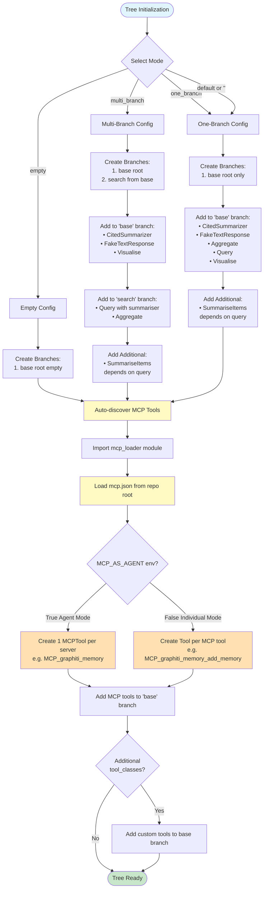

# Tool Discovery and Modular Initialization

## Overview

Elysia implements a modular tool discovery and initialization system that:
1. Centralizes default tool configurations
2. Automatically discovers and loads MCP tools
3. Provides utilities for generating tool discovery YAML configurations
4. Maintains separation between UI layer and core Tree logic

## System Components

### 1. Tool Discovery Utility (`elysia/util/tool_discovery.py`)

**Purpose:** Discover all available tools and generate YAML configurations

**Key Functions:**

- **`discover_tools_from_module()`**: Finds all Tool subclasses from custom_tools and MCP modules
- **`get_tool_metadata()`**: Extracts metadata from discovered tools
- **`generate_tool_discovery_yaml()`**: Creates YAML configuration file
- **`get_tools_by_category()`**: Filters tools by category

**Circular Import Handling:** Uses `TYPE_CHECKING` and late imports to avoid circular dependencies

### 2. UI Module for Default Tools (`elysia/tools/ui/default_tools.py`)

**Purpose:** Centralize tool loading logic for different initialization modes

**Key Features:**

#### DEFAULT_TOOL_CONFIGS

Dictionary defining tool configurations for each mode:

- **`multi_branch`**: Organizes tools into "base" and "search" branches
- **`one_branch`**: All tools in a single "base" branch  
- **`empty`**: No tools loaded by default

#### load_default_tools_for_mode()

Main function that loads tools based on mode:
- Automatically creates branches
- Adds tools to appropriate branches
- Supports `additional_tool_classes` parameter for dynamic tools
- Auto-discovers and loads MCP tools

**Circular Import Handling:** Direct imports from tool modules, `TYPE_CHECKING` for Tree

#### Default Tools Flow Diagram

The following diagram illustrates the complete tool loading flow during tree initialization:



*Source: [docs/diagram/default_tools_flow.mmd](../diagram/default_tools_flow.mmd)*

### 3. Tree Class Integration (`elysia/tree/tree.py`)

**Simplified Methods:**
- `multi_branch_init()`, `one_branch_init()`, and `empty_init()` use `load_default_tools_for_mode()`

**Auto-Loading Method:**
- `_load_additional_discovered_tools()`: Runs after base initialization
  - Automatically discovers and loads MCP tools
  - Filters for tools with "mcp" in their name
  - Adds them to the root branch

### 4. Tool Discovery YAML Configuration

**File:** `elysia/config/discovered_tools.yaml`

**Structure:**
```yaml
discovered_tools:
  retrieval:
    Query: 
      class_name: Query
      name: query
      description: Queries the knowledge base...
      available: true
    Aggregate: 
      class_name: Aggregate
      name: aggregate
      description: Aggregates information...
      available: true
  text:
    CitedSummarizer: {...}
    FakeTextResponse: {...}
  visualization:
    BasicLinearRegression: {...}
    Visualise: {...}
  postprocessing:
    SummariseItems: {...}
  mcp:
    # MCP tools dynamically added when configured
  other: {}
```

## API Flow

### /init/tree Endpoint Flow

1. **User Request** → `/init/tree/{user_id}/{conv_id}`
2. **UserManager.initialise_tree()** → Creates tree via TreeManager
3. **TreeManager.add_tree()** → Creates new Tree instance
4. **Tree.__init__()** → Calls `set_branch_initialisation()`
5. **set_branch_initialisation()** →
   - Calls mode-specific init (e.g., `one_branch_init()`)
   - `one_branch_init()` → `load_default_tools_for_mode(tree, "one_branch")`
   - Then calls `_load_additional_discovered_tools()`
6. **_load_additional_discovered_tools()** →
   - Discovers all tools via `discover_tools_from_module()`
   - Filters for MCP tools (tools with "mcp" in name)
   - Adds them to root branch via `add_tool()`
7. **Tree Ready** → MCP tools now available alongside default tools

## Key Benefits

1. **Modularity**: Tool loading logic is centralized and easily maintainable
2. **Extensibility**: New tools are automatically discovered and can be auto-loaded
3. **MCP Integration**: MCP tools configured in `mcp.json` are automatically added to trees
4. **No Code Changes Needed**: Just configure `mcp.json` and tools appear
5. **Backward Compatible**: Existing tool addition methods still work
6. **Clear Separation**: UI layer separate from core Tree logic

## Usage Examples

### Basic Usage (Automatic)

```python
from elysia import Tree

# MCP tools automatically loaded if configured in mcp.json
tree = Tree()  # or Tree(branch_initialisation="one_branch")
```

### Advanced Usage (Custom Tools)

```python
from elysia import Tree
from elysia.tools.ui import load_default_tools_for_mode
from my_tools import MyCustomTool

tree = Tree(branch_initialisation="empty")
load_default_tools_for_mode(
    tree,
    "one_branch",
    additional_tool_classes=[MyCustomTool]
)
```

### Generate Tool Discovery YAML

```python
from elysia.util import generate_tool_discovery_yaml

generate_tool_discovery_yaml('elysia/config/discovered_tools.yaml')
```

Or use the helper script:

```bash
python elysia/generate_discovered_tools.py
```

## Default Tool Configurations

### One Branch Mode

All tools in a single "base" branch:
- CitedSummarizer
- FakeTextResponse
- Aggregate
- Query (with SummariseItems dependency)
- Visualise

### Multi Branch Mode

Tools organized into branches:

**Base Branch:**
- CitedSummarizer
- FakeTextResponse
- Visualise

**Search Branch:** (from base)
- Aggregate
- Query (with SummariseItems dependency)

### Empty Mode

No default tools loaded - start with a clean slate.

## Files in the System

**Created:**
- `elysia/util/tool_discovery.py`
- `elysia/tools/ui/default_tools.py`
- `elysia/tools/ui/__init__.py`
- `elysia/config/discovered_tools.yaml`
- `elysia/generate_discovered_tools.py` (helper script)

**Modified:**
- `elysia/tree/tree.py`
- `elysia/util/__init__.py`

## MCP Tool Integration

To use MCP tools with the discovery system:

1. Configure MCP servers in `elysia/mcp.json`:
```json
{
  "servers": [
    {
      "name": "my_server",
      "description": "My MCP server",
      "server_script_path": "/path/to/server.py",
      "enabled": true
    }
  ]
}
```

2. Restart the service - MCP tools will be automatically discovered and added to trees
3. Verify via `/tools/available` endpoint

The system is ready for MCP tool integration with zero additional code changes required!

## Advanced: Customizing Tool Loading

For advanced use cases, you can customize which tools get loaded:

```python
from elysia import Tree
from elysia.tools.ui import DEFAULT_TOOL_CONFIGS, load_default_tools_for_mode

# Get the default config for one_branch mode
config = DEFAULT_TOOL_CONFIGS["one_branch"]

# Modify the config as needed
# Then use it with a custom tree initialization

# Or load tools selectively
from elysia.util.tool_discovery import discover_tools_from_module

all_tools = discover_tools_from_module()
retrieval_tools = [cls for name, cls in all_tools.items() 
                   if "query" in name.lower() or "aggregate" in name.lower()]

tree = Tree(branch_initialisation="empty")
for tool_cls in retrieval_tools:
    tree.add_tool(tool=tool_cls, branch_id="base")
```

---

See also:
- [Creating Tools](../creating_tools.md) - How to create custom tools
- [MCP Integration](../MCP/index.md) - MCP-specific documentation
- [Advanced Tool Construction](advanced_tool_construction.md) - In-depth tool creation guide


